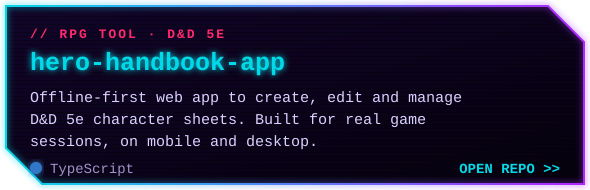
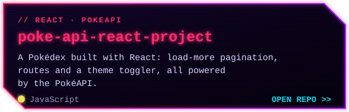
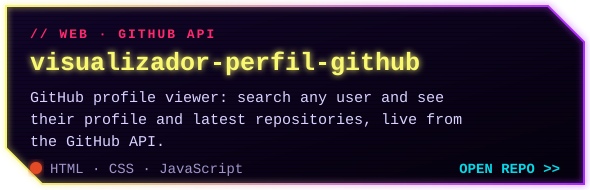
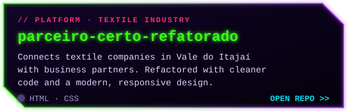

<div align="center">



<a href="https://github.com/MiguelCavilha">
  
</a>

<br/><br/>




<br/><br/>


<br/>


<br/>


<br/><br/>


<br/><br/>


<a href="https://github.com/MiguelCavilha/hero-handbook-app"></a>
<a href="https://github.com/MiguelCavilha/poke-api-react-project"></a>
<a href="https://github.com/MiguelCavilha/visualizador-perfil-github"></a>
<a href="https://github.com/MiguelCavilha/parceiro-certo-refatorado"></a>

<br/><br/>


</div>

```diff
@@ ~/learning --watch @@
+ [ RUNNING ] Python & FastAPI
+ [ RUNNING ] ASP.NET Core for APIs
+ [ RUNNING ] Game patterns in Unity 2D
+ [ RUNNING ] BI & dashboard best practices
+ [ RUNNING ] Prompt engineering for AI integrations
```

<div align="center">


<picture>
  <source media="(prefers-color-scheme: dark)" srcset="https://raw.githubusercontent.com/MiguelCavilha/MiguelCavilha/output/github-contribution-grid-snake-neon.svg" />
  <source media="(prefers-color-scheme: light)" srcset="https://raw.githubusercontent.com/MiguelCavilha/MiguelCavilha/output/github-contribution-grid-snake.svg" />
  
</picture>

<br/><br/>


<br/>

<a href="https://www.linkedin.com/in/luiz-miguel-cavilha-61a311242/"></a>
<a href="mailto:miguelcavilha@outlook.com"></a>
<a href="https://github.com/MiguelCavilha"></a>


<br/><br/>


</div>
